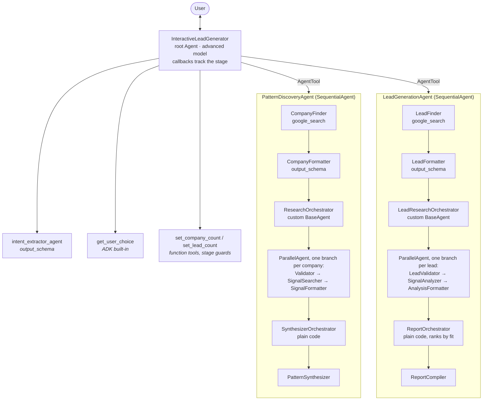
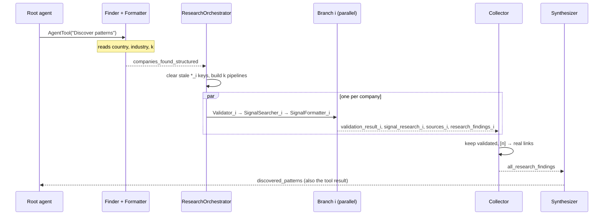

# Lead Generation Deep Research Agent (ADK)

| | |
|---|---|
| **Agent** | A multi-agent deep research system that finds companies about to enter a target market |
| **What it does** | Phase 1 researches companies that recently entered a market and extracts the signals they showed beforehand; phase 2 finds companies showing those signals now, validates and scores them, and writes a ranked lead report with real source links |
| **Built with** | Google ADK (`SequentialAgent`, `ParallelAgent`, custom `BaseAgent`, `AgentTool`), Google Search grounding, Gemini |
| **Video walkthrough** | [Watch on YouTube](https://www.youtube.com/watch?v=GGK-tBdYchU) |

A multi-agent deep research system that finds sales leads the way a market research team
would. Built with Google ADK, it works in two phases:

1. **Pattern discovery (learn from the past):** find companies that recently entered a target
   market (e.g. *fintech in Thailand*), research what each one did *before* entering (local
   hires, legal entity, licences, partnerships), and summarize the shared patterns.
2. **Lead generation (predict the future):** find companies showing those same signals *now*
   that haven't entered yet, validate them, score them against the patterns, and write a
   ranked report with sources.

You stay in control between the phases: you choose how many companies to study, confirm the
patterns, and choose how many leads to find.

Reference: [Build a deep research agent with Google ADK](https://cloud.google.com/blog/products/ai-machine-learning/build-a-deep-research-agent-with-google-adk)
([MagnIeeT/leadGenerationAgentADK](https://github.com/MagnIeeT/leadGenerationAgentADK))

## Example conversation

```
You:   Find fintech leads in Thailand
Agent: Target: Fintech in Thailand. How many past successful companies should I study?  [1] [2] [3] [5] [10]
You:   3
Agent: ...researches 3 companies in parallel...
       ## Patterns found, with [source] links
       Find new leads showing these patterns?  [Yes, find leads] [No]
You:   Yes, find leads
Agent: How many leads?  [1] [3] [5] [10]
You:   5
Agent: ...validates and analyzes 5 leads in parallel...
       ## Lead report: ranked table, evidence with links, missing signals, next step per lead
```

## Architecture



### How the agents share data

Agents never call each other directly. Each one writes its result to **session state** (via
`output_key` or a state delta) and the next one reads it. Per-item agents use numbered keys, so
parallel branches never overwrite each other.



## ADK concepts used

| Concept | Where |
|---|---|
| `SequentialAgent` | Each phase is a fixed five-step pipeline |
| `ParallelAgent` | Researches all companies (or leads) at the same time |
| Custom `BaseAgent` | `ParallelResearchOrchestrator` builds the parallel pipelines at run time, because the number of items is only known after the formatter runs. `ResultCollector` merges results with no LLM call. |
| `AgentTool` | Wraps each pipeline so the root agent calls it like a tool; state changes flow back to the parent session |
| `output_schema` (Pydantic) | Forces structured JSON (`schemas.py`) so the next step can rely on it |
| Researcher + formatter pairs | A model call can't use `google_search` and `output_schema` together, so one agent searches and the next formats |
| `output_key` + session state | How agents hand results to each other |
| InstructionProviders | Per-item prompts are Python functions, so ADK skips `{placeholder}` injection and company data containing braces can't break them |
| Callbacks | `before_agent_callback` sets default state; `after_tool_callback` advances the stage; `after_model_callback` adds citations |
| `get_user_choice` | Built-in long-running tool that shows clickable options |
| Two model tiers | Fast model for formatting and validation, advanced model for research and synthesis |

### Grounded citations

Search agents like to cite links from memory. Here, `save_grounding_sources`
(`sub_agents/common.py`) reads Gemini's grounding metadata, which lists the pages actually used
and which sentences each page supports. It then:

1. stores those pages in state as a numbered list (`sources_i`), and
2. inserts `[n]` markers after each supported sentence.

The formatter returns a `source_number` instead of a URL, and `ResultCollector` swaps it for the
real link in code, so the model can never invent or mix up a link. Links are Google's grounding
redirect URLs (`vertexaisearch.cloud.google.com/grounding-api-redirect/...`), which open the
original article.

## Project layout

```
01-lead-generation-agent/
├── lead_generation_agent/
│   ├── agent.py                  # root_agent: tools + callbacks
│   ├── prompt.py                 # stage-driven root instruction
│   ├── callbacks.py              # default state, stage transitions
│   ├── tools.py                  # set_company_count / set_lead_count (with stage guards)
│   ├── schemas.py                # Pydantic output schemas
│   ├── config.py                 # fast + advanced models with retries
│   └── sub_agents/
│       ├── intent_extractor.py   # country / industry / intent
│       ├── pattern_discovery.py  # phase 1 pipeline
│       ├── lead_generation.py    # phase 2 pipeline
│       └── common.py             # orchestrator, collector, validator, citations
├── tests/                        # offline tests, no Gemini calls
├── .env.example
├── DEMO.md                       # video walkthrough script
└── pyproject.toml
```

## Setup

Requires Python 3.11+ and [uv](https://docs.astral.sh/uv/).

```bash
cd 01-lead-generation-agent
uv sync
cp .env.example .env   # then add your Gemini API key
```

| Variable | Default | Used for |
|---|---|---|
| `GOOGLE_API_KEY` | | Google AI Studio key (or set the Vertex AI variables instead) |
| `GEN_FAST_MODEL` | `gemini-2.5-flash` | Formatters, validators, intent extraction |
| `GEN_ADVANCED_MODEL` | `gemini-2.5-pro` | Root agent, finders, signal research, synthesis, report |

> **Billing is required for real use.** One run with k=3 and m=5 makes about 35 model calls,
> many in parallel. On the free tier, `gemini-2.5-pro` has no quota at all, and Flash and
> Flash-Lite allow only 20 requests a day each. Enable billing on the key's project (a run
> costs cents with Flash). For free-tier experiments, set both models to `gemini-2.5-flash`
> and use k=1, m=1, about 15 calls. `gemini-2.5-flash-lite` runs the pipelines but is too
> weak to drive the conversation reliably.

## Run

Run from inside `01-lead-generation-agent/`:

```bash
uv run adk web                          # browser UI, pick "lead_generation_agent"
uv run adk run lead_generation_agent    # terminal chat
```

In `adk web`, open the **State** tab to watch `stage`, `k`, `m` and the per-company keys
appear, and the **Events** tab to see each sub-agent's run.

Example prompts:

- "Find fintech leads in Thailand"
- "I want leads for EV charging companies" (the agent asks for the missing country)
- "Which healthcare SaaS companies might enter Germany next?"

### Stages

| Stage | Set by | Next action |
|---|---|---|
| `intent` | default | call `intent_extractor_agent` |
| `choose_k` | `after_tool_run`, once country and industry are known | ask k, `set_company_count` |
| `pattern_discovery` | `set_company_count` | `PatternDiscoveryAgent` |
| `patterns_ready` | `after_tool_run`, once `discovered_patterns` exists | show patterns, ask m, `set_lead_count` |
| `lead_generation` | `set_lead_count` | `LeadGenerationAgent` |
| `done` | `after_tool_run`, once `final_lead_report` exists | show report, offer more leads or a new target |

The count tools refuse to run out of order (no target → no k; no patterns → no m), so a model
mistake can't skip a phase.

## Tests

```bash
uv run pytest
```

11 offline tests, no API key needed:

- `test_citations.py`: `[n]` markers land after the right segments (byte offsets, multi-byte
  text), sources are deduplicated, numbers map to real links
- `test_orchestration.py`: fake agents check the dynamic `ParallelAgent` fan-out, that invalid
  items are dropped and the rest ranked, that stale keys are cleared, and the empty case
- `test_tools.py`: stage guards and validation on the count tools

## Changes from the reference

| Area | Reference | This project |
|---|---|---|
| ADK / tooling | ADK 1.x, Poetry, Python 3.9 | ADK 2.13, uv, Python 3.11+ |
| Models | `gemini-2.0-flash` + `gemini-2.5-pro` | `gemini-2.5-flash` + `gemini-2.5-pro`, configurable, with retries on 429/5xx |
| Stage tracking | `after_tool_callback` compared `tool is intent_extractor_agent` (the tool is the `AgentTool` wrapper) and `isinstance(..., IntentExtractionResult)` (state holds a dict), so stages never advanced | compares `tool.name`, accepts dict or JSON string; stage transitions verified live |
| Prompts | `instruction.format(**ctx.session.state)`, which breaks on braces or missing keys | InstructionProviders built from state; ADK skips placeholder injection for them |
| Citations | model-written links | grounding metadata → `[n]` markers → links resolved in code |
| Out-of-order calls | none | count tools check the stage; the `next_step` hint keeps weaker models moving |
| Re-runs | per-item keys from an earlier run could leak into the next | orchestrator clears its own keys first |
| Leads | could include the companies just studied | studied companies excluded; validator rejects companies already in the target country |
| Code reuse | separate orchestrators per phase | shared `ParallelResearchOrchestrator`, `ResultCollector`, `make_validator` |
| Tests | none | 11 offline tests |

## Known limitations

- `SequentialAgent` and `ParallelAgent` are deprecated in ADK 2.x in favour of `Workflow`.
  They are kept because `Workflow` can't yet run under an `LlmAgent`, which this design needs
  (each pipeline is an `AgentTool` of the root agent). The deprecation warning is silenced in
  `common.py` and in the pytest config.
- The agent researches exactly m leads. If some fail validation (e.g. already in the
  country), the report has fewer than m; ask for more leads to try again.
- Research quality depends on what Google Search returns; scores are model judgements, not
  ground truth.
