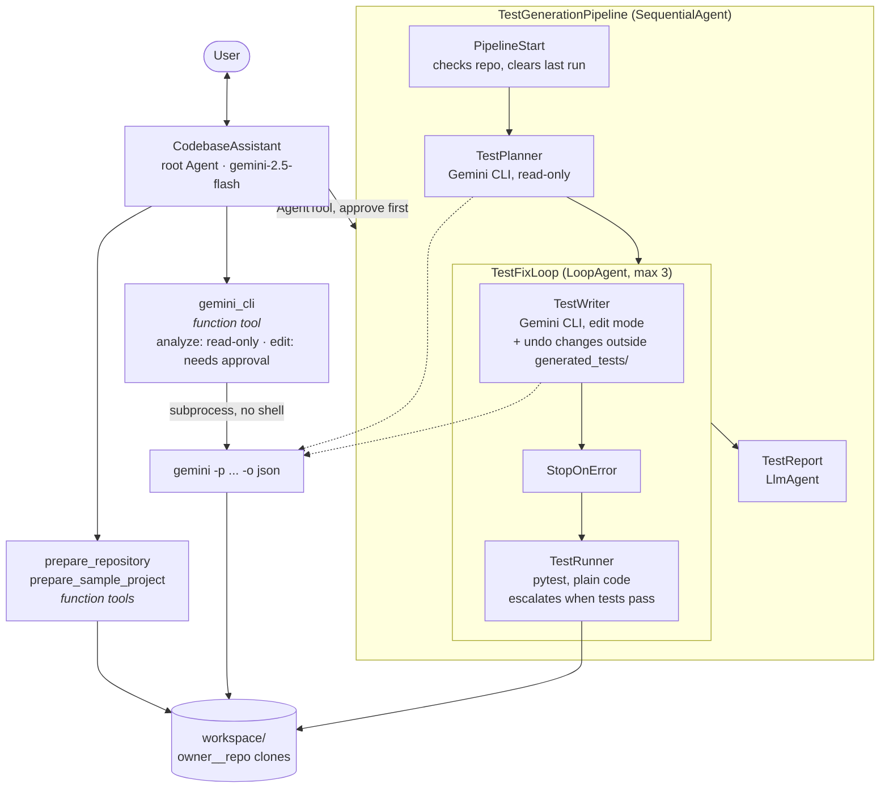
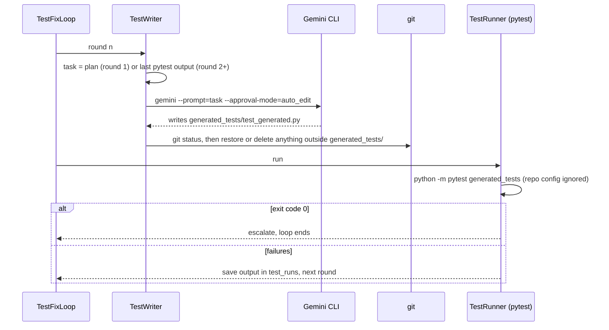

# Gemini CLI inside an ADK Pipeline

An ADK agent that uses [Gemini CLI](https://github.com/google-gemini/gemini-cli), Google's
open-source coding agent, as a tool. ADK handles the conversation and the workflow. Gemini
CLI does the hands-on work on a real codebase: reading and searching files, and writing
tests.

It can:

1. **Analyze any public GitHub repository:** architecture, code quality, test plans, with
   file paths.
2. **Generate working unit tests:** a pipeline that plans tests, has Gemini CLI write them,
   runs them with pytest and feeds failures back until they pass (at most 3 rounds). Tests
   that expose a real bug are kept and marked as possible bugs instead of being deleted.

References: [Gemini CLI as a tool in ADK](https://medium.com/google-cloud/supercharge-your-ai-agents-using-gemini-cli-as-a-tool-in-adk-4d8d8d0dad6e)
by derrickchwong ([derrickchwong/gemini-cli-on-adk](https://github.com/derrickchwong/gemini-cli-on-adk))

**Video walkthrough:** _link coming soon_

## Example conversations

```
You:   Explain the architecture of github.com/psf/requests
Agent: prepare_repository → gemini_cli (read-only)
       ### Main modules: src/requests/api.py, sessions.py, models.py, adapters.py ...
       ### How a request flows: requests.get() → Session.request() → PreparedRequest
           → HTTPAdapter.send() → urllib3 → Response
       ### Design patterns: Facade (api.py), Strategy (transport adapters), hooks
```

```
You:   Use the sample project and generate unit tests for the Cart class and pricing
Agent: prepare_sample_project → TestGenerationPipeline   [Approve?  yes / no]
       Round 1: 1 failed, 16 passed  (tests need fixing)
       Round 2: 16 passed, 1 xfailed (all generated tests pass)
       Possible bugs: remove() with a negative quantity increases the quantity
```

## Architecture



### How one test generation round flows



Only `TestReport` uses the ADK model. The planner, writer and runner are custom `BaseAgent`s
that call Gemini CLI or pytest directly, so the order of steps never depends on a model
choosing a tool, and a run costs only 1-2 ADK model requests.

## ADK concepts used

| Concept | Where |
|---|---|
| Function tools | `prepare_repository`, `prepare_sample_project`, `gemini_cli` (`tools.py`), async, read and write session state through `ToolContext` |
| Tool confirmation | `FunctionTool(gemini_cli, require_confirmation=...)` asks only for `mode="edit"`; `ConfirmedAgentTool` asks before every pipeline run |
| `AgentTool` | wraps the pipeline so the root agent calls it like a tool; state changes flow back |
| `SequentialAgent` | the pipeline's fixed steps |
| `LoopAgent` | write → run → fix, ending early with `escalate=True` when the tests pass |
| Custom `BaseAgent` | `GeminiCliStep`, `TestRunner`, `PipelineStart`, `StopOnError`, `SkipIfError`: code steps with no model call |
| InstructionProvider | the report prompt is built from state in Python |
| `{repo_url?}` state injection | the root prompt shows the current repository |
| Retries | the ADK model retries 429/5xx with backoff |

## Using Gemini CLI safely as a tool

Gemini CLI is an agent that can edit files and run commands, so this project treats every call
as untrusted:

| Risk | What this project does |
|---|---|
| Shell injection through the URL or task | URLs must match `https://github.com/owner/repo`; `git` and `gemini` get argument lists, never a shell. A test passes a task containing `"; touch pwned` and `--approval-mode=yolo`. |
| "Read-only" runs that write | **`--approval-mode plan` is not read-only headless:** with no one to confirm, the CLI approved its own `exit_plan_mode` and then wrote a file in testing. Read-only runs add `--policy policies/read_only.toml`, which denies `write_file`, `replace`, `run_shell_command` and `exit_plan_mode`. |
| The repository configuring the CLI | Headless runs need `--skip-trust`, which makes the CLI trust the workspace. A repo could ship `.gemini/settings.json` (hooks and MCP servers run commands) or a `.env` (e.g. pointing the API at another server). Both are deleted from the clone before every run. |
| Edits to the code under test | The test writer may only add `generated_tests/`; everything else is restored with git after each round. |
| Running the repository's code | pytest runs the generated tests, which import the repo. The user approves each pipeline run; pytest skips the repo's `conftest.py` and pytest config. |
| Hangs and huge output | Timeouts kill the process (CLI 600 s, clone and pytest 300 s); answers over 20,000 characters are cut. |
| Wrong credentials | The CLI keeps its own login, separate from the ADK key. |

Edit mode (`auto_edit`) auto-approves file edits, but shell commands still need approval,
which headless mode turns into a denial. So even the test writer can't run commands; pytest
runs from our own code.

## Project layout

```
02-gemini-cli-adk-agent/
├── gemini_cli_agent/
│   ├── agent.py              # root_agent and its four tools
│   ├── prompt.py             # root instruction
│   ├── tools.py              # clone, sample project, Gemini CLI runner
│   ├── pipeline.py           # TestGenerationPipeline
│   ├── config.py             # models, CLI path/model/timeout, workspace
│   └── policies/read_only.toml
├── sample_project/           # small shopping_cart package, no tests (demo target)
├── tests/                    # 42 offline tests, fake Gemini CLI
├── workspace/                # clones (git-ignored)
├── .env.example
├── DEMO.md                   # video walkthrough script
└── pyproject.toml
```

## Setup

Requires Python 3.11+, [uv](https://docs.astral.sh/uv/), git and Node.js 20+.

```bash
npm install -g @google/gemini-cli
gemini                 # once, interactively: pick "Login with Google" or "Use Gemini API Key"

cd 02-gemini-cli-adk-agent
uv sync
cp .env.example .env   # add your ADK key; set GEMINI_CLI_MODEL
gemini --list-models   # models your CLI login can use
```

| Variable | Default | Used for |
|---|---|---|
| `GOOGLE_API_KEY` | | Google AI Studio key for the ADK agent |
| `GEMINI_MODEL` | `gemini-2.5-flash` | ADK root agent and report |
| `GEMINI_CLI_MODEL` | CLI default | Gemini CLI model. `auto` often hit 503s in testing; `gemini-3.1-flash-lite` was reliable |
| `GEMINI_API_KEY` | | Optional. Key for the CLI, avoids an occasional keychain read failure (error code 41) |
| `GEMINI_CLI_PATH` | `gemini` | CLI binary |
| `GEMINI_CLI_TIMEOUT` | `600` | Seconds per CLI call |
| `WORKSPACE_DIR` | `./workspace` | Where repositories are cloned |

The ADK key and the CLI login are separate and can belong to different projects. If the CLI
reports a model as "no longer available to new users", pick one from `gemini --list-models`.

> **Quota:** every CLI call sends about 9k tokens of the CLI's own system prompt, and a test
> generation run makes 2-4 CLI calls. The free tier allows 20 requests a day per model on the
> ADK key; a billed key is recommended for recording.

## Run

Run from inside `02-gemini-cli-adk-agent/`:

```bash
uv run adk web                       # browser UI, pick "gemini_cli_agent"
uv run adk run gemini_cli_agent      # terminal chat
```

In `adk web`, the pipeline shows an approve/reject prompt before it runs. Open the **State**
tab to see `repo_path`, `test_plan`, `test_runs` and `possible_bugs`.

Example prompts:

- "Explain the architecture of https://github.com/psf/requests"
- "Review the code quality of src/requests/sessions.py, with file:line references"
- "What's tested today and what isn't? Give a prioritized test plan."
- "Use the sample project and generate unit tests for the Cart class and pricing functions"
- "Add a docstring to every public function in pricing.py" (edit mode, asks first)

The generated tests stay in the clone: `workspace/<folder>/generated_tests/test_generated.py`.

## Tests

```bash
uv run pytest
```

42 offline tests, no API keys needed. A fake `gemini` script replays scripted answers and file
writes; git and pytest are real.

- `test_tools.py`: URL validation (including injection attempts), clone reuse and cleanup,
  read-only vs edit flags, the task as one argument, removal of the repo's CLI config, error
  JSON on stderr, the login hint, timeouts, truncation, the policy file
- `test_pipeline.py`: a full write → fail → fix → pass run with off-limits edits undone; the
  3-round limit; CLI errors stopping the pipeline; re-runs starting clean; pytest ignoring the
  repo's conftest and config; the confirmation; the root agent's tools

## Changes from the reference

| Area | Reference | This project |
|---|---|---|
| ADK | `google-adk` ~1.6 | 2.13 |
| Running the CLI | `subprocess.run(f'gemini -p "{task}"', shell=True)`: a quote in the task breaks out into the shell | argument list, no shell, async with timeout |
| Cloning | any URL, `shell=True`, into `/tmp/<repo>` (two owners' repos with the same name collide) | `https://github.com/owner/repo` only, shallow clone, no shell, `owner__repo` folders, failed clones removed |
| Permissions | no approval mode | read-only by default (plan mode + deny policy); edits only after the user approves |
| Repository config | trusted implicitly | repo's `.gemini/` and `.env` removed before each run |
| Output | plain text | `-o json`: answer, tools used, structured errors (also from stderr) |
| Pipeline | a single tool call | plan → write/run/fix loop → report, with pytest as the judge |
| Model | `gemini-2.5-pro` hard-coded | configurable for ADK and the CLI |
| Tests | starter-pack dummy test and an agent smoke test | 42 offline tests of the tools and the pipeline |
| Deployment | Cloud Run via Terraform / Cloud Build (Agent Starter Pack) | local only (see limitations) |

## Known limitations

- Generated tests run in this project's Python environment. A repository whose dependencies
  aren't installed there fails at import; the report says so. The bundled sample project has
  no dependencies.
- Test generation targets Python projects (pytest).
- Only public GitHub repositories can be cloned.
- A model error from Gemini CLI (e.g. 503 high demand) ends the pipeline run; try again or
  switch `GEMINI_CLI_MODEL`.
- `SequentialAgent` and `LoopAgent` are deprecated in ADK 2.x in favour of `Workflow`, which
  can't yet run under an `LlmAgent` (as an `AgentTool`). The warning is silenced.
- Cloud Run deployment is not included. The reference's Dockerfile approach (Node 20 +
  `npm install -g @google/gemini-cli` in the image) would work, but the CLI's login must then
  come from `GEMINI_API_KEY`.
