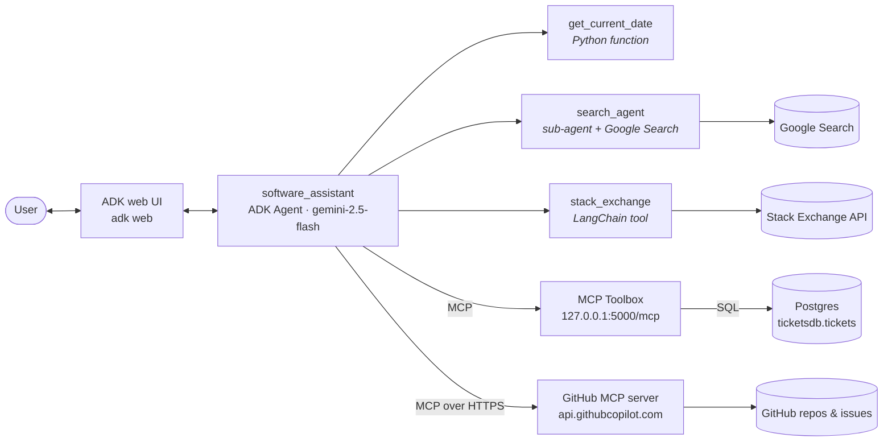
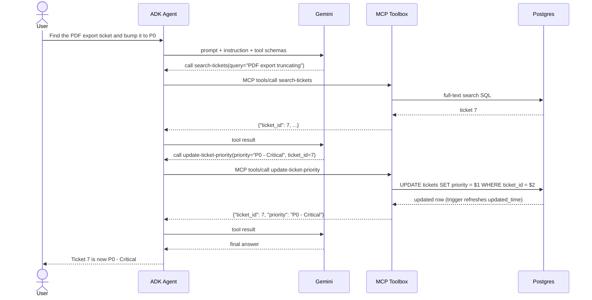

# Software Bug Assistant (ADK + MCP)

A conversational assistant that helps IT support and developers triage software bugs.
Built with Google ADK, it combines five tool types:

- Python function tool (current date)
- Built-in Google Search (in a sub-agent wrapped by `GoogleSearchAgentTool`)
- LangChain StackExchange tool (Stack Overflow)
- MCP Toolbox for Databases (Postgres `tickets` table)
- GitHub remote MCP server (issues and pull requests)

Reference: [Tools make an agent: from zero to assistant with ADK](https://cloud.google.com/blog/topics/developers-practitioners/tools-make-an-agent-from-zero-to-assistant-with-adk)

**Video walkthrough:** _link coming soon_

## Architecture



### How a request flows

Example: *"Find the PDF export ticket and bump it to P0"*



Gemini only chooses tools and fills in their parameters. ADK runs the calls. The SQL and
database credentials stay inside MCP Toolbox.

## Project layout

```
03-bug-assistant-mcp/
├── software_bug_assistant/
│   ├── agent.py              # root_agent: model + instruction + tools
│   ├── prompt.py             # system instruction
│   └── tools/tools.py        # the five tool types
├── deployment/db/            # init.sql + setup_local.sh
├── deployment/mcp-toolbox/   # tools.yaml, local.yaml, run_local.sh
├── .env.example
├── DEMO.md                   # video walkthrough script
└── pyproject.toml
```

## Setup

Requires Python 3.11+ and [uv](https://docs.astral.sh/uv/).

```bash
cd 03-bug-assistant-mcp
uv sync
cp .env.example .env   # then fill in your keys
```

## Local database (Postgres)

The agent's internal tickets live in a Postgres `ticketsdb` database with one `tickets` table
(id, title, description, assignee, priority, status, timestamps) and 10 sample bugs. A trigger
keeps `updated_time` current on every update.

```bash
brew install postgresql@14           # if not installed
brew services start postgresql@14
# set DB_USER and DB_PASS in .env first
./deployment/db/setup_local.sh       # creates the role + database, loads deployment/db/init.sql
```

The script is safe to re-run; it resets the table to the 10 sample tickets. Verify with:

```bash
psql -h 127.0.0.1 -U postgres -d ticketsdb -c "SELECT ticket_id, title, priority, status FROM tickets;"
```

> Note: Homebrew's Postgres uses `trust` authentication for local connections, so any password
> is accepted from your own machine. Use real password authentication for any shared or hosted
> database.

## MCP Toolbox for Databases

[MCP Toolbox](https://github.com/googleapis/mcp-toolbox) is an MCP server that turns SQL
statements declared in YAML into tools an agent can call. The agent never sees credentials or
writes SQL; it only calls named tools.

| File | Purpose |
|---|---|
| `deployment/mcp-toolbox/tools.yaml` | 8 ticket tools + the `tickets_toolset` group, shared by all environments |
| `deployment/mcp-toolbox/local.yaml` | Local Postgres source + a full-text `search-tickets` |
| `deployment/mcp-toolbox/run_local.sh` | Downloads Toolbox v1.15.0 on first run, starts it with both files |

Tools in `tickets_toolset`: `search-tickets`, `get-ticket-by-id`, `get-tickets-by-assignee`,
`get-tickets-by-status`, `get-tickets-by-priority`, `get-tickets-by-date-range`,
`update-ticket-priority`, `update-ticket-status`, `create-new-ticket`.

Start it in its own terminal and leave it running:

```bash
./deployment/mcp-toolbox/run_local.sh
# ... INFO "Initialized 9 tools: ..."
# ... INFO "Server ready to serve!"
```

It serves MCP at `http://127.0.0.1:5000/mcp`. `search-tickets` uses Postgres full-text search
(any query word may match, ranked by relevance). Because the environment-specific pieces live in
`local.yaml`, a hosted deployment can add its own overlay, e.g. Cloud SQL with vector
embeddings, under the same tool name without changing the agent.

> macOS note: AirPlay Receiver also listens on port 5000, and `localhost` resolves to it (IPv6)
> and returns 403. Always use `127.0.0.1:5000`, which is what `MCP_TOOLBOX_URL` defaults to.

## The agent

`root_agent` is a single ADK `Agent` on `gemini-2.5-flash` (override with `GEMINI_MODEL`) with
five kinds of tools, all defined in `software_bug_assistant/tools/tools.py`:

| Tool | Type | Wired up with |
|---|---|---|
| `get_current_date` | Python function | passed directly; ADK reads the docstring |
| `search_agent` | Built-in Google Search | sub-agent wrapped in `GoogleSearchAgentTool` (built-in search can't share an agent with other tools) |
| `stack_exchange` | LangChain tool | `LangchainTool(StackExchangeTool(...))` |
| 9 ticket tools | MCP Toolbox for Databases | `ToolboxToolset(MCP_TOOLBOX_URL, toolset_name="tickets_toolset")`, connects lazily at run time |
| 6 GitHub tools | Remote MCP server | `MCPToolset` over streamable HTTP to `api.githubcopilot.com/mcp/`, read-only `tool_filter` |

GitHub tools are skipped with a warning until `GITHUB_PERSONAL_ACCESS_TOKEN` in `.env` holds a
real token. Gemini calls retry with exponential backoff on 429/5xx errors.

## Run

Run these from inside `03-bug-assistant-mcp/`. Running `adk web` from the repo root makes ADK
load the agent under the wrong app name and it returns no responses.

```bash
# terminal 1: ticket tools
./deployment/mcp-toolbox/run_local.sh

# terminal 2: the agent
uv run adk web    # browser UI, pick "software_bug_assistant"
uv run adk run software_bug_assistant   # terminal chat
```

Example prompts:

- "What tickets were created this week?" (`get_current_date` + `get-tickets-by-date-range`)
- "Any issues around database timeouts?" (`search-tickets`)
- "Show all open tickets assigned to frank.white@example.com" (`get-tickets-by-assignee`)
- "Find the PDF export ticket and bump it to P0" (`search-tickets` -> `update-ticket-priority`)
- "Create a bug: password reset emails never reach Outlook addresses" (duplicate check -> `create-new-ticket`)
- "What are possible root causes for a login page freezing? Search the web." (`search_agent`)
- "Any Stack Overflow discussions about CVE-2024-3094?" (`stack_exchange`)
- "List the latest 5 open issues on psf/requests" (GitHub MCP)

Reset the sample data at any time with `./deployment/db/setup_local.sh`.

> Gemini free tier limits: `gemini-2.5-flash` allows 5 requests/minute and 20 requests/day, and
> one question can take 2-4 model calls. Use a billed API key or Vertex AI for heavier testing.

## Changes from the reference sample

The original sample (`google/adk-samples`, `python/agents/software-bug-assistant`) targeted
ADK 1.x and MCP Toolbox v0.6. This version was rebuilt against current releases:

| Area | Reference | This project |
|---|---|---|
| ADK | `google-adk` 1.8 | `google-adk[mcp,toolbox]` 2.13 (MCP and Toolbox are optional extras) |
| Toolbox config | single-map `tools.yaml`, `--tools-file` | v1.15 multi-document YAML, `--configs tools.yaml,local.yaml` |
| Toolbox client | `ToolboxSyncClient` at import time; tools silently vanish if Toolbox is down | ADK `ToolboxToolset`, connects lazily when the agent runs |
| Local search | `search-tickets` needed Cloud SQL embeddings; broken locally | full-text `search-tickets` in `local.yaml` |
| SQL tools | `ticket_id` typed as string; date range excluded the end date; blank create values not defaulted | integer IDs, inclusive date range, `NULLIF`/`COALESCE` defaults, updates return the changed row |
| Google Search | hand-built `AgentTool` | `GoogleSearchAgentTool` (propagates grounding metadata) |
| GitHub token | placeholder token caused 401s mid-conversation | placeholder detected; GitHub tools skipped with a warning |
| Resilience | none | Gemini retries with exponential backoff on 429/500/503/504 |
| Toolbox security | listens for any host/origin | `--allowed-hosts` / `--allowed-origins` restricted to localhost |
| DB setup | SQL pasted by hand | `setup_local.sh` + `init.sql`, re-runnable, password read from `.env` |
