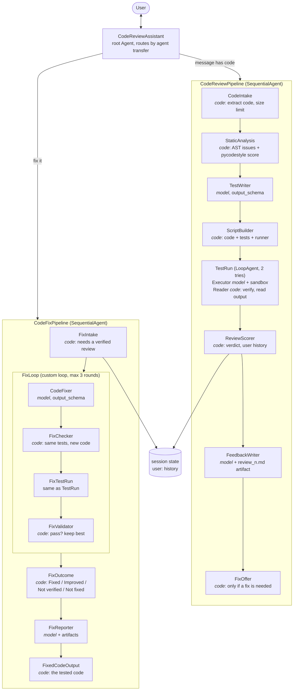
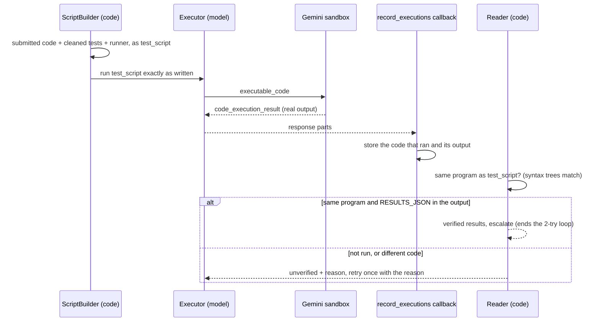
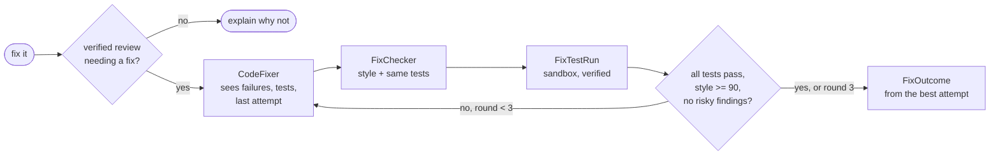

# Code Review Assistant (ADK)

| | |
|---|---|
| **Agent** | A production quality Python code review and fix assistant |
| **What it does** | Reviews pasted code (AST checks, PEP 8 score, unit tests executed and verified in Gemini's sandbox), then on "fix it" fixes the code and re-runs the same tests until they pass |
| **Built with** | Google ADK (agent transfer, custom agents, `BuiltInCodeExecutor`, plugins, artifacts, SQLite sessions, `adk eval`), Gemini code execution, pycodestyle |
| **Video walkthrough** | [Watch on YouTube](https://www.youtube.com/watch?v=PFH9yRJJxeg) |

A production quality Python code review assistant built with Google ADK. Paste Python code and
it:

1. **Reviews it:** structure (AST), PEP 8 style with a 0-100 score, and unit tests written by
   Gemini and **executed in Gemini's code execution sandbox**. A plain-code verdict is followed
   by a written review citing line numbers.
2. **Fixes it** when you reply "fix it": a fixer rewrites the code, and the **same tests** are
   re-run on each attempt until every test passes and the style score reaches 90 (at most 3
   rounds). You get the exact code that passed, not a model's retyped copy.

It also tracks each user's reviews across sessions, saves reports and fixed code as artifacts,
counts model calls and tokens, refuses oversized requests before they cost anything, keeps
sessions in SQLite and ships an `adk eval` set.

Reference: [ayoisio/adk-code-review-assistant](https://github.com/ayoisio/adk-code-review-assistant)

## Example conversation

```
You:   Please review this:
       def dfs(graph, start):
           """Performs depth-first search on a graph."""
           visited = set()
           stack = start
           ...
Agent: [CodeIntake]     Reviewing 12 lines of code.
       [StaticAnalysis] Found 1 functions and 0 classes; style score 100/100 with 0 issues.
       [TestRunReader]  Tests: 0 passed, 0 failed, 7 errors (of 7).
       [ReviewScorer]   Verdict: Needs major fixes.
       ## Test results  0 of 7 tests passed. AttributeError: 'str' object has no
                        attribute 'pop' (submission.py line 7) ...
       ## Bugs found    Line 4: stack = start should be stack = [start] ...
       **Reply "fix it" and I'll fix these issues and re-run the same tests.**

You:   fix it
Agent: [FixValidator]   Round 1: 7 of 7 tests pass, style 100/100; fix accepted.
       [FixOutcome]     Outcome: Fixed.
       | Tests passing | 0/7 | 7/7 |  ...
       Fixed code:
       def dfs(graph, start): ... stack = [start] ... graph.get(current, []) ...
```

## Architecture



Steps marked *code* are custom `BaseAgent`s: exact, free, and never skipped or reordered by
a model. A review takes about 4 model calls (route, write tests, run them, write the review)
and a fix about 2-3 per round.

### How a test run is verified

Models are good at writing tests and bad at reporting on them honestly. In testing, a model
sometimes wrote plausible results as text without running anything, or ran its own simpler
test harness. So the model only *runs* the script, and code checks that it really did:



- **The submission is never retyped by a model before testing.** `harness.py` embeds it as a
  readable raw string and runs each `test_*` function with a 5 second timeout.
- **Results come from the sandbox's output**, not the model's summary: the runner prints one
  `RESULTS_JSON:` line.
- **The executed code must be the same program.** The check compares syntax trees, so dropped
  comments and re-indentation are fine. Any change to the code or the tests fails it.
- **Unverified results can never produce "Ready to use".** The verdict becomes "Not verified"
  and fixing is refused, because a fix couldn't be checked either.

### The fix loop



`FixLoop` is a small custom agent, not a `LoopAgent`. In ADK a `LoopAgent` stops on **any**
`escalate`, and the verified test run inside each round escalates to end its own retry loop.
A `LoopAgent` here would stop after round 1 even when the fix failed. `test_failed_round_is_retried`
covers this.

## ADK concepts used

| Concept | Where |
|---|---|
| Agent transfer | the root's `sub_agents=[code_review_pipeline, code_fix_pipeline]`; the pipelines answer the user directly |
| `SequentialAgent` | both pipelines |
| `LoopAgent` | `TestRun`: executor + reader, ended by `escalate` once results are verified |
| Custom `BaseAgent` | `CodeIntake`, `StaticAnalysis`, `ScriptBuilder`, `ResultReader`, `ReviewScorer`, `FixOffer`, `FixChecker`, `FixValidator`, `FixLoop`, `FixOutcome`, `FixedCodeOutput`, `Gate` |
| `BuiltInCodeExecutor` | Gemini code execution runs the tests in Google's sandbox |
| `after_model_callback` | `record_executions` reads `executable_code` / `code_execution_result` parts |
| `output_schema` | `TestSuite` (tests + intended behaviour), `CodeFix` (code, changes, disputed tests) |
| InstructionProviders | every prompt is built from state in Python (line-numbered code, failing tests, last attempt) |
| `include_contents="none"` | workers see only what their instruction gives them |
| State scopes | session keys per review/fix; `user:review_count`, `user:last_review`, `user:fix_count`, `user:usage_today` across sessions; `temp:` for the callback |
| Artifacts | `review_n.md`, `fix_report_n.md`, `fixed_code_n.py` via `after_agent_callback` |
| `App` + plugins | `UsagePlugin`, `LimitsPlugin` (`plugins.py`), loaded by `adk web`/`run`/`eval` |
| Session service | SQLite via `--session_service_uri` |
| Evaluation | `adk eval` with the built-in trajectory metric and two custom metrics |
| Retries | the Gemini model retries 429/5xx with backoff (`config.py`) |

## Production features

| Feature | How |
|---|---|
| Trustworthy test results | verified sandbox runs (above); the verdict is computed in code |
| Usage accounting | `UsagePlugin` counts model calls and prompt/output/thinking tokens per agent, per session (`usage`) and per user per day (`user:usage_today`), and logs one line per run |
| Input limits | `LimitsPlugin` refuses messages over `MAX_MESSAGE_CHARS` and users over `MAX_MODEL_CALLS_PER_USER_PER_DAY` **before any model call**; `CodeIntake` also limits the code to `MAX_CODE_CHARS` |
| Persistence | `adk web --session_service_uri sqlite:///./sessions.db`: review history, usage and conversations survive restarts (tested) |
| Evaluation | `evals/`: 5 cases, routing checked exactly, verdict/outcome/fix offer checked by a custom metric, every test run must be verified |
| Reports | reviews, fix reports and fixed code saved as artifacts |
| Configuration | models, limits and thresholds from `.env` |

## Setup

Requires Python 3.11+ and [uv](https://docs.astral.sh/uv/).

```bash
cd 04-code-review-assistant
uv sync
cp .env.example .env   # add your Google AI Studio key
```

| Variable | Default | Used for |
|---|---|---|
| `GOOGLE_API_KEY` | | Google AI Studio key |
| `WORKER_MODEL` | `gemini-2.5-flash` | routing, test writing and running, fixing |
| `CRITIC_MODEL` | `gemini-2.5-flash` | the review and fix reports (the reference used `gemini-2.5-pro`, which needs billing) |
| `MAX_CODE_CHARS` | `20000` | largest submission |
| `MAX_MESSAGE_CHARS` | `25000` | longest chat message, checked before any model call |
| `MAX_MODEL_CALLS_PER_USER_PER_DAY` | `100` | per-user daily budget |
| `PASSING_STYLE_SCORE` | `90` | style a fix must reach |
| `MAX_FIX_ROUNDS` | `3` | fix attempts |

> **Quota:** the free tier allows 20 requests a day per model. A review plus a fix uses about
> 7-9. Newer models (for example `gemini-3.5-flash`) have their own quota; in our live run it
> ran both test scripts correctly on the first try. `gemini-2.5-flash-lite` didn't use the code
> execution tool, so its reviews came out "Not verified".

## Run

From inside `04-code-review-assistant/`:

```bash
uv run adk web --session_service_uri "sqlite:///./sessions.db"   # browser UI, persistent sessions
uv run adk web                                                   # in-memory sessions
uv run adk run code_review_assistant                             # terminal chat
```

Pick `code_review_assistant`, paste code (ideally in a ```` ```python ```` block), then reply
"fix it". In `adk web`:

- **Events:** the executor's `executable_code` and `code_execution_result` parts, showing the
  sandbox really ran.
- **State:** `test_results` (`status: verified`), `review_summary`, `fix_history`, `usage`,
  `user:usage_today`.
- **Artifacts:** `review_1.md`, `fix_report_1.md` and `fixed_code_1.py`.

## Evaluate

```bash
uv run adk eval code_review_assistant evals/code_review.evalset.json \
    --config_file_path evals/test_config.json --print_detailed_results
```

| Case | Checks |
|---|---|
| `explains_without_code` | no transfer, no pipeline runs |
| `fix_without_review` | routes to the fix pipeline, which explains there's nothing to fix |
| `reviews_buggy_code` | routes to review; "Needs major fixes"; the fix offer |
| `clean_code_is_ready` | a correct function is "Ready to use" with no fix offer |
| `review_then_fix` | two turns: review, then "Outcome: Fixed." |

| Metric | What it checks |
|---|---|
| `tool_trajectory_avg_score` (built-in) | the `transfer_to_agent` calls match exactly |
| `pipeline_steps_match` (`evals/metrics.py`) | the plain-code steps' messages (intake, verdict, fix offer, fix outcome) match exactly. The model's wording can vary, the results can't |
| `tests_verified` (`evals/metrics.py`) | every sandbox test run ended verified (a successful retry counts) |

The eval makes about 20 model calls.

## Tests

```bash
uv run pytest
```

68 offline tests, about 7 seconds, no API key needed. Fake agents replace the model-backed
steps; the code steps, the retry loops, ADK runners and SQLite are real, and test scripts
really run with a local Python.

- `test_analysis.py` (16): code extraction, AST findings, the style score
- `test_harness.py` (18): the runner on buggy and fixed code, timeouts, load errors, raw
  string embedding, test cleaning, the same-program check (including a dropped comment, as seen live)
- `test_review_pipeline.py` (12): verified results, a tampered run rejected, history across
  sessions, old results cleared, the fix offer only when needed, verdict rules, the retry reason
- `test_fix_pipeline.py` (12): fixed in round 1, a failed round retried, the round limit,
  syntax-error attempts, unverified runs reported as "Not verified", the instructions, artifacts
- `test_production.py` (5): usage counts that survive a restart, history in SQLite, both limits
- `test_evals.py` (5): the eval set and config load; the metrics pass and fail correctly

## Changes from the reference

| Area | Reference | This project |
|---|---|---|
| ADK | `google-adk` ^1.14 | 2.13+ (`App`, plugins, SQLite sessions) |
| Analysis and style | LLM agents that call the analysis tools | plain-code steps: same results, no model calls |
| Test results | the test runner model writes the results JSON itself | the sandbox output is read in code, and the run must be the generated script |
| Tests per review | 15-20 | 6-10 short tests (long scripts made the sandbox model stop copying) |
| Verdict | written by the model | computed in code; "Not verified" when tests didn't really run |
| Fix loop | `LoopAgent` + an `exit_fix_loop` tool the validator model calls | custom loop with a plain-code validator: all tests pass, style >= 90, no risky findings |
| Fixer prompt | includes the DFS demo's fixes (`stack = [start]`, `graph.get`) | generic: failing tests, findings, tests, and the previous attempt |
| Fixed code shown | rewritten by the synthesizer model | the exact code that passed |
| Models | `gemini-2.5-pro` critic (needs billing) | flash by default, configurable |
| Usage and limits | not included | `UsagePlugin`, `LimitsPlugin` |
| Sessions | in-memory, `DatabaseSessionService` or Vertex AI | in-memory or SQLite |
| Tests | 3 `AgentEvaluator` tests whose `tests/integration/*.test.json` files are missing, and an Agent Engine test | 68 offline tests plus a 5-case `adk eval` set with custom metrics |
| Deployment | Cloud Run and Agent Engine scripts | local only (see limitations) |

## Known limitations

- Only Python, one module per review. Tests run in Gemini's sandbox, so code that needs
  packages the sandbox lacks, files, network or input fails to load.
- Tests are written by a model and can be wrong. The fixer can dispute a test
  (`disputed_tests`), but the fix then can't reach "Fixed"; the report lists the disputed tests.
- Gemini code execution depends on the model actually using the tool. When it doesn't, results
  are "Not verified" instead of wrong, but you need to retry.
- The per-user daily budget counts model calls, not tokens.
- `SequentialAgent` and `LoopAgent` are deprecated in ADK 2.x in favour of `Workflow`, which
  can't yet be a sub-agent for agent transfer. The warning is silenced.
- Cloud deployment is not included. `adk deploy cloud_run` would work with
  `--session_service_uri` pointing at a managed database.
